<!--
  This README is generated by generator/ and rebuilt every night by
  .github/workflows/profile.yml. Edit generator/src/readme.ts instead.
-->

<picture><source media="(prefers-color-scheme: dark)" srcset="https://raw.githubusercontent.com/DavidNiessen/DavidNiessen/output/hero-dark.svg"><source media="(prefers-color-scheme: light)" srcset="https://raw.githubusercontent.com/DavidNiessen/DavidNiessen/output/hero-light.svg"></picture>

<a href="https://niessen.dev/in"><picture><source media="(prefers-color-scheme: dark)" srcset="https://raw.githubusercontent.com/DavidNiessen/DavidNiessen/output/social-linkedin-dark.svg"><source media="(prefers-color-scheme: light)" srcset="https://raw.githubusercontent.com/DavidNiessen/DavidNiessen/output/social-linkedin-light.svg"></picture></a>
<a href="https://niessen.dev/ig"><picture><source media="(prefers-color-scheme: dark)" srcset="https://raw.githubusercontent.com/DavidNiessen/DavidNiessen/output/social-instagram-dark.svg"><source media="(prefers-color-scheme: light)" srcset="https://raw.githubusercontent.com/DavidNiessen/DavidNiessen/output/social-instagram-light.svg"></picture></a>
<a href="https://niessen.dev"><picture><source media="(prefers-color-scheme: dark)" srcset="https://raw.githubusercontent.com/DavidNiessen/DavidNiessen/output/social-web-dark.svg"><source media="(prefers-color-scheme: light)" srcset="https://raw.githubusercontent.com/DavidNiessen/DavidNiessen/output/social-web-light.svg"></picture></a>
<a href="https://github.com/DavidNiessen"><picture><source media="(prefers-color-scheme: dark)" srcset="https://raw.githubusercontent.com/DavidNiessen/DavidNiessen/output/social-github-dark.svg"><source media="(prefers-color-scheme: light)" srcset="https://raw.githubusercontent.com/DavidNiessen/DavidNiessen/output/social-github-light.svg"></picture></a>

<picture><source media="(prefers-color-scheme: dark)" srcset="https://raw.githubusercontent.com/DavidNiessen/DavidNiessen/output/divider-dark.svg"><source media="(prefers-color-scheme: light)" srcset="https://raw.githubusercontent.com/DavidNiessen/DavidNiessen/output/divider-light.svg"></picture>

<picture><source media="(prefers-color-scheme: dark)" srcset="https://raw.githubusercontent.com/DavidNiessen/DavidNiessen/output/terminal-dark.svg"><source media="(prefers-color-scheme: light)" srcset="https://raw.githubusercontent.com/DavidNiessen/DavidNiessen/output/terminal-light.svg"></picture>

<picture><source media="(prefers-color-scheme: dark)" srcset="https://raw.githubusercontent.com/DavidNiessen/DavidNiessen/output/stats-dark.svg"><source media="(prefers-color-scheme: light)" srcset="https://raw.githubusercontent.com/DavidNiessen/DavidNiessen/output/stats-light.svg"></picture>

<picture><source media="(prefers-color-scheme: dark)" srcset="https://raw.githubusercontent.com/DavidNiessen/DavidNiessen/output/contrib-dark.svg"><source media="(prefers-color-scheme: light)" srcset="https://raw.githubusercontent.com/DavidNiessen/DavidNiessen/output/contrib-light.svg"></picture>

<picture><source media="(prefers-color-scheme: dark)" srcset="https://raw.githubusercontent.com/DavidNiessen/DavidNiessen/output/snake-dark.svg"><source media="(prefers-color-scheme: light)" srcset="https://raw.githubusercontent.com/DavidNiessen/DavidNiessen/output/snake-light.svg"></picture>

<picture><source media="(prefers-color-scheme: dark)" srcset="https://raw.githubusercontent.com/DavidNiessen/DavidNiessen/output/pulse-dark.svg"><source media="(prefers-color-scheme: light)" srcset="https://raw.githubusercontent.com/DavidNiessen/DavidNiessen/output/pulse-light.svg"></picture>

<picture><source media="(prefers-color-scheme: dark)" srcset="https://raw.githubusercontent.com/DavidNiessen/DavidNiessen/output/skyline-dark.gif"><source media="(prefers-color-scheme: light)" srcset="https://raw.githubusercontent.com/DavidNiessen/DavidNiessen/output/skyline-light.gif"></picture>
<picture><source media="(prefers-color-scheme: dark)" srcset="https://raw.githubusercontent.com/DavidNiessen/DavidNiessen/output/life-dark.gif"><source media="(prefers-color-scheme: light)" srcset="https://raw.githubusercontent.com/DavidNiessen/DavidNiessen/output/life-light.gif"></picture>

<picture><source media="(prefers-color-scheme: dark)" srcset="https://raw.githubusercontent.com/DavidNiessen/DavidNiessen/output/divider-dark.svg"><source media="(prefers-color-scheme: light)" srcset="https://raw.githubusercontent.com/DavidNiessen/DavidNiessen/output/divider-light.svg"></picture>

<a href="https://github.com/DavidNiessen/soundwave"><picture><source media="(prefers-color-scheme: dark)" srcset="https://raw.githubusercontent.com/DavidNiessen/DavidNiessen/output/now-dark.svg"><source media="(prefers-color-scheme: light)" srcset="https://raw.githubusercontent.com/DavidNiessen/DavidNiessen/output/now-light.svg"></picture></a>

<picture><source media="(prefers-color-scheme: dark)" srcset="https://raw.githubusercontent.com/DavidNiessen/DavidNiessen/output/stack-dark.svg"><source media="(prefers-color-scheme: light)" srcset="https://raw.githubusercontent.com/DavidNiessen/DavidNiessen/output/stack-light.svg"></picture>

<picture><source media="(prefers-color-scheme: dark)" srcset="https://raw.githubusercontent.com/DavidNiessen/DavidNiessen/output/languages-dark.svg"><source media="(prefers-color-scheme: light)" srcset="https://raw.githubusercontent.com/DavidNiessen/DavidNiessen/output/languages-light.svg"></picture>
<picture><source media="(prefers-color-scheme: dark)" srcset="https://raw.githubusercontent.com/DavidNiessen/DavidNiessen/output/rhythm-dark.svg"><source media="(prefers-color-scheme: light)" srcset="https://raw.githubusercontent.com/DavidNiessen/DavidNiessen/output/rhythm-light.svg"></picture>

<picture><source media="(prefers-color-scheme: dark)" srcset="https://raw.githubusercontent.com/DavidNiessen/DavidNiessen/output/journey-dark.svg"><source media="(prefers-color-scheme: light)" srcset="https://raw.githubusercontent.com/DavidNiessen/DavidNiessen/output/journey-light.svg"></picture>

<a href="https://github.com/DavidNiessen?tab=overview"><picture><source media="(prefers-color-scheme: dark)" srcset="https://raw.githubusercontent.com/DavidNiessen/DavidNiessen/output/board-dark.svg"><source media="(prefers-color-scheme: light)" srcset="https://raw.githubusercontent.com/DavidNiessen/DavidNiessen/output/board-light.svg"></picture></a>

<a href="https://github.com/DavidNiessen/AdvancedMLGRush"><picture><source media="(prefers-color-scheme: dark)" srcset="https://raw.githubusercontent.com/DavidNiessen/DavidNiessen/output/project-1-dark.svg"><source media="(prefers-color-scheme: light)" srcset="https://raw.githubusercontent.com/DavidNiessen/DavidNiessen/output/project-1-light.svg"></picture></a>
<a href="https://github.com/DavidNiessen/gtb-solver"><picture><source media="(prefers-color-scheme: dark)" srcset="https://raw.githubusercontent.com/DavidNiessen/DavidNiessen/output/project-2-dark.svg"><source media="(prefers-color-scheme: light)" srcset="https://raw.githubusercontent.com/DavidNiessen/DavidNiessen/output/project-2-light.svg"></picture></a>

<a href="https://github.com/DavidNiessen/soundwave"><picture><source media="(prefers-color-scheme: dark)" srcset="https://raw.githubusercontent.com/DavidNiessen/DavidNiessen/output/project-3-dark.svg"><source media="(prefers-color-scheme: light)" srcset="https://raw.githubusercontent.com/DavidNiessen/DavidNiessen/output/project-3-light.svg"></picture></a>
<a href="https://github.com/DavidNiessen/lexicon-mcp"><picture><source media="(prefers-color-scheme: dark)" srcset="https://raw.githubusercontent.com/DavidNiessen/DavidNiessen/output/project-4-dark.svg"><source media="(prefers-color-scheme: light)" srcset="https://raw.githubusercontent.com/DavidNiessen/DavidNiessen/output/project-4-light.svg"></picture></a>

<picture><source media="(prefers-color-scheme: dark)" srcset="https://raw.githubusercontent.com/DavidNiessen/DavidNiessen/output/trophies-dark.svg"><source media="(prefers-color-scheme: light)" srcset="https://raw.githubusercontent.com/DavidNiessen/DavidNiessen/output/trophies-light.svg"></picture>
<picture><source media="(prefers-color-scheme: dark)" srcset="https://raw.githubusercontent.com/DavidNiessen/DavidNiessen/output/today-dark.svg"><source media="(prefers-color-scheme: light)" srcset="https://raw.githubusercontent.com/DavidNiessen/DavidNiessen/output/today-light.svg"></picture>

<picture><source media="(prefers-color-scheme: dark)" srcset="https://raw.githubusercontent.com/DavidNiessen/DavidNiessen/output/divider-dark.svg"><source media="(prefers-color-scheme: light)" srcset="https://raw.githubusercontent.com/DavidNiessen/DavidNiessen/output/divider-light.svg"></picture>

<picture><source media="(prefers-color-scheme: dark)" srcset="https://raw.githubusercontent.com/DavidNiessen/DavidNiessen/output/footer-dark.svg"><source media="(prefers-color-scheme: light)" srcset="https://raw.githubusercontent.com/DavidNiessen/DavidNiessen/output/footer-light.svg"></picture>

