<!--
  Generated by Readme Studio (https://readme.niessen.dev/).
  Edit readme.config.json instead of this file: the Readme Studio workflow rebuilds it.
  Open the design in the visual editor: https://readme.niessen.dev/#/studio?repo=DavidNiessen/DavidNiessen
  Agent guide: https://readme.niessen.dev/llms.txt
-->

<picture><source media="(prefers-color-scheme: dark)" srcset="https://raw.githubusercontent.com/DavidNiessen/DavidNiessen/readme-studio/hero-dark.svg"><source media="(prefers-color-scheme: light)" srcset="https://raw.githubusercontent.com/DavidNiessen/DavidNiessen/readme-studio/hero-light.svg"></picture>

<a href="https://niessen.dev"><picture><source media="(prefers-color-scheme: dark)" srcset="https://raw.githubusercontent.com/DavidNiessen/DavidNiessen/readme-studio/socials-1-website-dark.svg"><source media="(prefers-color-scheme: light)" srcset="https://raw.githubusercontent.com/DavidNiessen/DavidNiessen/readme-studio/socials-1-website-light.svg"></picture></a>
<a href="https://niessen.dev/in"><picture><source media="(prefers-color-scheme: dark)" srcset="https://raw.githubusercontent.com/DavidNiessen/DavidNiessen/readme-studio/socials-2-linkedin-dark.svg"><source media="(prefers-color-scheme: light)" srcset="https://raw.githubusercontent.com/DavidNiessen/DavidNiessen/readme-studio/socials-2-linkedin-light.svg"></picture></a>
<a href="https://niessen.dev/ig"><picture><source media="(prefers-color-scheme: dark)" srcset="https://raw.githubusercontent.com/DavidNiessen/DavidNiessen/readme-studio/socials-3-instagram-dark.svg"><source media="(prefers-color-scheme: light)" srcset="https://raw.githubusercontent.com/DavidNiessen/DavidNiessen/readme-studio/socials-3-instagram-light.svg"></picture></a>
<a href="https://github.com/DavidNiessen"><picture><source media="(prefers-color-scheme: dark)" srcset="https://raw.githubusercontent.com/DavidNiessen/DavidNiessen/readme-studio/socials-4-github-dark.svg"><source media="(prefers-color-scheme: light)" srcset="https://raw.githubusercontent.com/DavidNiessen/DavidNiessen/readme-studio/socials-4-github-light.svg"></picture></a>

<picture><source media="(prefers-color-scheme: dark)" srcset="https://raw.githubusercontent.com/DavidNiessen/DavidNiessen/readme-studio/divider-dark.svg"><source media="(prefers-color-scheme: light)" srcset="https://raw.githubusercontent.com/DavidNiessen/DavidNiessen/readme-studio/divider-light.svg"></picture>

<a href="https://github.com/DavidNiessen"><picture><source media="(prefers-color-scheme: dark)" srcset="https://raw.githubusercontent.com/DavidNiessen/DavidNiessen/readme-studio/terminal-dark.svg"><source media="(prefers-color-scheme: light)" srcset="https://raw.githubusercontent.com/DavidNiessen/DavidNiessen/readme-studio/terminal-light.svg"></picture></a>

<picture><source media="(prefers-color-scheme: dark)" srcset="https://raw.githubusercontent.com/DavidNiessen/DavidNiessen/readme-studio/stats-dark.svg"><source media="(prefers-color-scheme: light)" srcset="https://raw.githubusercontent.com/DavidNiessen/DavidNiessen/readme-studio/stats-light.svg"></picture>

<picture><source media="(prefers-color-scheme: dark)" srcset="https://raw.githubusercontent.com/DavidNiessen/DavidNiessen/readme-studio/contrib-dark.svg"><source media="(prefers-color-scheme: light)" srcset="https://raw.githubusercontent.com/DavidNiessen/DavidNiessen/readme-studio/contrib-light.svg"></picture>

<a href="https://github.com/DavidNiessen"><picture><source media="(prefers-color-scheme: dark)" srcset="https://raw.githubusercontent.com/DavidNiessen/DavidNiessen/readme-studio/pulse-dark.svg"><source media="(prefers-color-scheme: light)" srcset="https://raw.githubusercontent.com/DavidNiessen/DavidNiessen/readme-studio/pulse-light.svg"></picture></a>

<a href="https://github.com/DavidNiessen"><picture><source media="(prefers-color-scheme: dark)" srcset="https://raw.githubusercontent.com/DavidNiessen/DavidNiessen/readme-studio/skyline-dark.gif"><source media="(prefers-color-scheme: light)" srcset="https://raw.githubusercontent.com/DavidNiessen/DavidNiessen/readme-studio/skyline-light.gif"></picture></a>

<picture><source media="(prefers-color-scheme: dark)" srcset="https://raw.githubusercontent.com/DavidNiessen/DavidNiessen/readme-studio/divider-2-dark.svg"><source media="(prefers-color-scheme: light)" srcset="https://raw.githubusercontent.com/DavidNiessen/DavidNiessen/readme-studio/divider-2-light.svg"></picture>

<a href="https://github.com/DavidNiessen/readme-studio"><picture><source media="(prefers-color-scheme: dark)" srcset="https://raw.githubusercontent.com/DavidNiessen/DavidNiessen/readme-studio/now-dark.svg"><source media="(prefers-color-scheme: light)" srcset="https://raw.githubusercontent.com/DavidNiessen/DavidNiessen/readme-studio/now-light.svg"></picture></a>

<picture><source media="(prefers-color-scheme: dark)" srcset="https://raw.githubusercontent.com/DavidNiessen/DavidNiessen/readme-studio/stack-dark.svg"><source media="(prefers-color-scheme: light)" srcset="https://raw.githubusercontent.com/DavidNiessen/DavidNiessen/readme-studio/stack-light.svg"></picture>

<a href="https://github.com/DavidNiessen?tab=repositories"><picture><source media="(prefers-color-scheme: dark)" srcset="https://raw.githubusercontent.com/DavidNiessen/DavidNiessen/readme-studio/languages-dark.svg"><source media="(prefers-color-scheme: light)" srcset="https://raw.githubusercontent.com/DavidNiessen/DavidNiessen/readme-studio/languages-light.svg"></picture></a>
<picture><source media="(prefers-color-scheme: dark)" srcset="https://raw.githubusercontent.com/DavidNiessen/DavidNiessen/readme-studio/rhythm-dark.svg"><source media="(prefers-color-scheme: light)" srcset="https://raw.githubusercontent.com/DavidNiessen/DavidNiessen/readme-studio/rhythm-light.svg"></picture>

<picture><source media="(prefers-color-scheme: dark)" srcset="https://raw.githubusercontent.com/DavidNiessen/DavidNiessen/readme-studio/journey-dark.svg"><source media="(prefers-color-scheme: light)" srcset="https://raw.githubusercontent.com/DavidNiessen/DavidNiessen/readme-studio/journey-light.svg"></picture>

<a href="https://github.com/DavidNiessen"><picture><source media="(prefers-color-scheme: dark)" srcset="https://raw.githubusercontent.com/DavidNiessen/DavidNiessen/readme-studio/board-dark.svg"><source media="(prefers-color-scheme: light)" srcset="https://raw.githubusercontent.com/DavidNiessen/DavidNiessen/readme-studio/board-light.svg"></picture></a>

<a href="https://github.com/DavidNiessen/soundwave"><picture><source media="(prefers-color-scheme: dark)" srcset="https://raw.githubusercontent.com/DavidNiessen/DavidNiessen/readme-studio/project-1-dark.svg"><source media="(prefers-color-scheme: light)" srcset="https://raw.githubusercontent.com/DavidNiessen/DavidNiessen/readme-studio/project-1-light.svg"></picture></a>
<a href="https://github.com/DavidNiessen/readme-studio"><picture><source media="(prefers-color-scheme: dark)" srcset="https://raw.githubusercontent.com/DavidNiessen/DavidNiessen/readme-studio/project-2-dark.svg"><source media="(prefers-color-scheme: light)" srcset="https://raw.githubusercontent.com/DavidNiessen/DavidNiessen/readme-studio/project-2-light.svg"></picture></a>

<a href="https://github.com/DavidNiessen/doctopus"><picture><source media="(prefers-color-scheme: dark)" srcset="https://raw.githubusercontent.com/DavidNiessen/DavidNiessen/readme-studio/project-3-dark.svg"><source media="(prefers-color-scheme: light)" srcset="https://raw.githubusercontent.com/DavidNiessen/DavidNiessen/readme-studio/project-3-light.svg"></picture></a>
<a href="https://github.com/DavidNiessen/frame"><picture><source media="(prefers-color-scheme: dark)" srcset="https://raw.githubusercontent.com/DavidNiessen/DavidNiessen/readme-studio/project-4-dark.svg"><source media="(prefers-color-scheme: light)" srcset="https://raw.githubusercontent.com/DavidNiessen/DavidNiessen/readme-studio/project-4-light.svg"></picture></a>

<a href="https://github.com/DavidNiessen/lexicon-mcp"><picture><source media="(prefers-color-scheme: dark)" srcset="https://raw.githubusercontent.com/DavidNiessen/DavidNiessen/readme-studio/project-5-dark.svg"><source media="(prefers-color-scheme: light)" srcset="https://raw.githubusercontent.com/DavidNiessen/DavidNiessen/readme-studio/project-5-light.svg"></picture></a>
<a href="https://github.com/DavidNiessen/skills"><picture><source media="(prefers-color-scheme: dark)" srcset="https://raw.githubusercontent.com/DavidNiessen/DavidNiessen/readme-studio/project-6-dark.svg"><source media="(prefers-color-scheme: light)" srcset="https://raw.githubusercontent.com/DavidNiessen/DavidNiessen/readme-studio/project-6-light.svg"></picture></a>

<picture><source media="(prefers-color-scheme: dark)" srcset="https://raw.githubusercontent.com/DavidNiessen/DavidNiessen/readme-studio/trophies-dark.svg"><source media="(prefers-color-scheme: light)" srcset="https://raw.githubusercontent.com/DavidNiessen/DavidNiessen/readme-studio/trophies-light.svg"></picture>
<picture><source media="(prefers-color-scheme: dark)" srcset="https://raw.githubusercontent.com/DavidNiessen/DavidNiessen/readme-studio/today-dark.svg"><source media="(prefers-color-scheme: light)" srcset="https://raw.githubusercontent.com/DavidNiessen/DavidNiessen/readme-studio/today-light.svg"></picture>

<picture><source media="(prefers-color-scheme: dark)" srcset="https://raw.githubusercontent.com/DavidNiessen/DavidNiessen/readme-studio/divider-3-dark.svg"><source media="(prefers-color-scheme: light)" srcset="https://raw.githubusercontent.com/DavidNiessen/DavidNiessen/readme-studio/divider-3-light.svg"></picture>

<a href="https://readme.niessen.dev/"><picture><source media="(prefers-color-scheme: dark)" srcset="https://raw.githubusercontent.com/DavidNiessen/DavidNiessen/readme-studio/footer-dark.svg"><source media="(prefers-color-scheme: light)" srcset="https://raw.githubusercontent.com/DavidNiessen/DavidNiessen/readme-studio/footer-light.svg"></picture></a>

