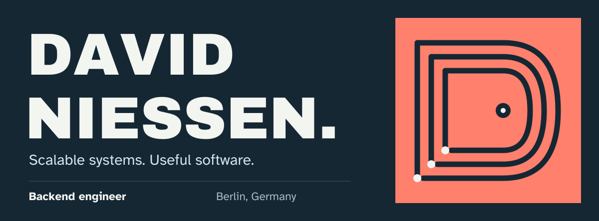
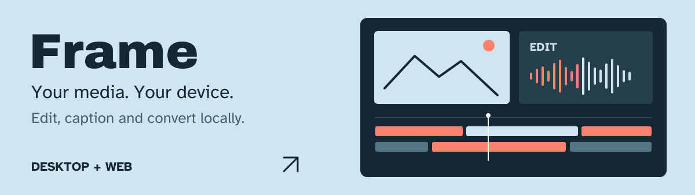
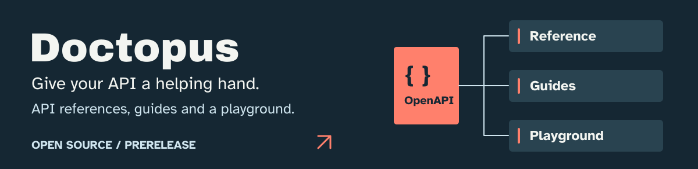
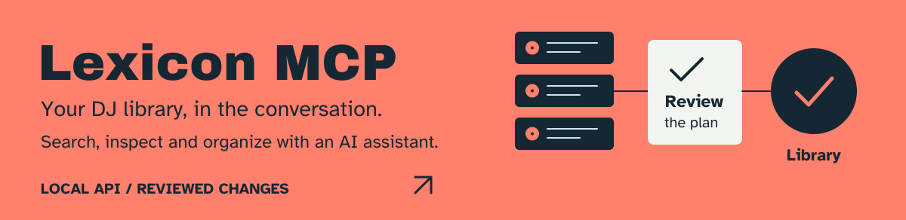
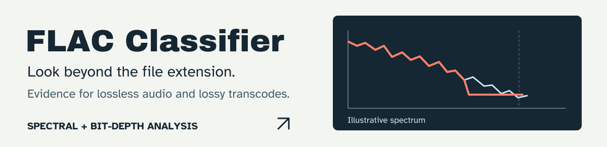
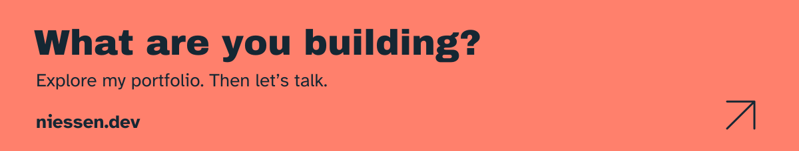

  <a href="https://niessen.dev/"><strong>Explore my portfolio ↗</strong></a>
  &nbsp;&nbsp;·&nbsp;&nbsp;
  <a href="#selected-work">Selected work</a>
  &nbsp;&nbsp;·&nbsp;&nbsp;
  <a href="https://niessen.dev/in">LinkedIn</a>
  &nbsp;&nbsp;·&nbsp;&nbsp;
  <a href="https://niessen.dev/ig">Instagram</a>

 

I'm **David**, a backend engineer at **Axel Springer SE**, based in **Berlin**. I build scalable, cloud-native systems, and spend my own time making creative tools, developer tooling and software that makes everyday things easier.

**21 years old** &nbsp; / &nbsp; **Born 31 December 2004**

 

## Selected work

A few projects worth opening. Explore the source, try a demo, or bring an idea to the issue tracker.

### Frame

Edit images, video and audio, add captions, or convert an entire folder. Processing stays on your device, with desktop and web versions. **Actively developed; desktop builds include prereleases.**

**[Source ↗](https://github.com/DavidNiessen/frame)** &nbsp; · &nbsp; [Try Frame](https://frame.niessen.dev/) &nbsp; · &nbsp; [Desktop downloads](https://github.com/DavidNiessen/frame/releases)

 

### Doctopus

An open-source home for API documentation: turn OpenAPI specifications into reference pages, combine them with guides, and explore requests in an interactive playground. **Currently in prerelease development.**

**[Source ↗](https://github.com/DavidNiessen/doctopus)** &nbsp; · &nbsp; [Explore the demo](https://doctopus.niessen.dev/)

 

### Lexicon MCP

Connect an AI assistant to your Lexicon DJ library. Search tracks, inspect library health and organize playlists through the local API, with a saved plan and explicit review before changes are applied.

**[Source ↗](https://github.com/DavidNiessen/lexicon-mcp)** &nbsp; · &nbsp; [Get started](https://github.com/DavidNiessen/lexicon-mcp#quick-start)

 

### FLAC Classifier

A FLAC extension doesn't tell the whole story. This tool analyzes spectral and bit-depth evidence to help distinguish genuine lossless audio, upsampled files and lossy transcodes, including uncertain results when the evidence isn't conclusive.

**[Source ↗](https://github.com/DavidNiessen/flac-classifier)** &nbsp; · &nbsp; [Usage and classifications](https://github.com/DavidNiessen/flac-classifier#classifications)

 

### Small tools, everyday problems

**[cpyurl](https://github.com/DavidNiessen/cpyurl)** — Copy the current tab as a plain URL, Markdown or HTML with a shortcut.

**[PACE Webhook Service](https://github.com/DavidNiessen/pace-webhook-service)** — Send the Axel Springer canteen menu to webhooks.

**[Disruption Notifier](https://github.com/DavidNiessen/disruption-notifier)** — Turn Berlin S-Bahn disruptions into webhook notifications.

 

  <a href="https://niessen.dev/"><strong>Portfolio ↗</strong></a>
  &nbsp;&nbsp;·&nbsp;&nbsp;
  <a href="https://niessen.dev/in">Connect on LinkedIn</a>
  &nbsp;&nbsp;·&nbsp;&nbsp;
  <a href="https://github.com/DavidNiessen?tab=repositories">All repositories</a>

 

  
A little movement from my contribution graph

   
  

