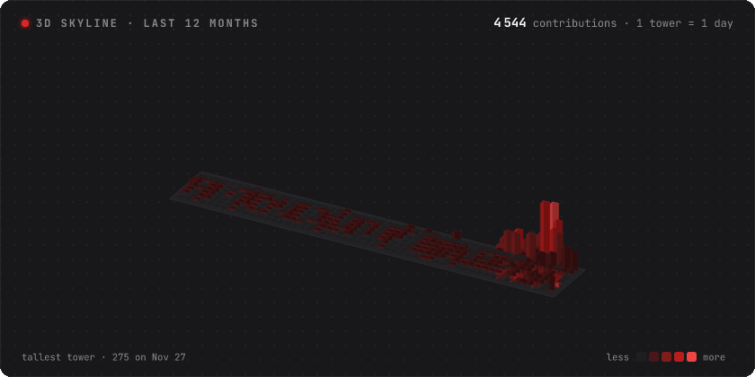

<!--
  Generated by Readme Studio (https://github.com/DavidNiessen/readme-studio).
  Edit readme.config.json instead of this file: it is rebuilt by .github/workflows/readme.yml.
  Open the design in the visual editor: https://readme.niessen.dev/#/studio?repo=DavidNiessen/DavidNiessen
  Agent guide: https://readme.niessen.dev/llms.txt
-->

<picture><source media="(prefers-color-scheme: dark)" srcset="https://raw.githubusercontent.com/DavidNiessen/DavidNiessen/output/hero-dark.svg"><source media="(prefers-color-scheme: light)" srcset="https://raw.githubusercontent.com/DavidNiessen/DavidNiessen/output/hero-light.svg"></picture>

<a href="https://niessen.dev/in"><picture><source media="(prefers-color-scheme: dark)" srcset="https://raw.githubusercontent.com/DavidNiessen/DavidNiessen/output/socials-1-linkedin-dark.svg"><source media="(prefers-color-scheme: light)" srcset="https://raw.githubusercontent.com/DavidNiessen/DavidNiessen/output/socials-1-linkedin-light.svg"></picture></a>
<a href="https://niessen.dev/ig"><picture><source media="(prefers-color-scheme: dark)" srcset="https://raw.githubusercontent.com/DavidNiessen/DavidNiessen/output/socials-2-instagram-dark.svg"><source media="(prefers-color-scheme: light)" srcset="https://raw.githubusercontent.com/DavidNiessen/DavidNiessen/output/socials-2-instagram-light.svg"></picture></a>
<a href="https://niessen.dev"><picture><source media="(prefers-color-scheme: dark)" srcset="https://raw.githubusercontent.com/DavidNiessen/DavidNiessen/output/socials-3-website-dark.svg"><source media="(prefers-color-scheme: light)" srcset="https://raw.githubusercontent.com/DavidNiessen/DavidNiessen/output/socials-3-website-light.svg"></picture></a>
<a href="https://github.com/DavidNiessen"><picture><source media="(prefers-color-scheme: dark)" srcset="https://raw.githubusercontent.com/DavidNiessen/DavidNiessen/output/socials-4-github-dark.svg"><source media="(prefers-color-scheme: light)" srcset="https://raw.githubusercontent.com/DavidNiessen/DavidNiessen/output/socials-4-github-light.svg"></picture></a>

<picture><source media="(prefers-color-scheme: dark)" srcset="https://raw.githubusercontent.com/DavidNiessen/DavidNiessen/output/divider-dark.svg"><source media="(prefers-color-scheme: light)" srcset="https://raw.githubusercontent.com/DavidNiessen/DavidNiessen/output/divider-light.svg"></picture>

<a href="https://github.com/DavidNiessen"><picture><source media="(prefers-color-scheme: dark)" srcset="https://raw.githubusercontent.com/DavidNiessen/DavidNiessen/output/terminal-dark.svg"><source media="(prefers-color-scheme: light)" srcset="https://raw.githubusercontent.com/DavidNiessen/DavidNiessen/output/terminal-light.svg"></picture></a>

<picture><source media="(prefers-color-scheme: dark)" srcset="https://raw.githubusercontent.com/DavidNiessen/DavidNiessen/output/stats-dark.svg"><source media="(prefers-color-scheme: light)" srcset="https://raw.githubusercontent.com/DavidNiessen/DavidNiessen/output/stats-light.svg"></picture>

<picture><source media="(prefers-color-scheme: dark)" srcset="https://raw.githubusercontent.com/DavidNiessen/DavidNiessen/output/contrib-dark.svg"><source media="(prefers-color-scheme: light)" srcset="https://raw.githubusercontent.com/DavidNiessen/DavidNiessen/output/contrib-light.svg"></picture>

<a href="https://github.com/DavidNiessen"><picture><source media="(prefers-color-scheme: dark)" srcset="https://raw.githubusercontent.com/DavidNiessen/DavidNiessen/output/pulse-dark.svg"><source media="(prefers-color-scheme: light)" srcset="https://raw.githubusercontent.com/DavidNiessen/DavidNiessen/output/pulse-light.svg"></picture></a>

<a href="https://github.com/DavidNiessen"><picture><source media="(prefers-color-scheme: dark)" srcset="https://raw.githubusercontent.com/DavidNiessen/DavidNiessen/output/skyline-dark.gif"><source media="(prefers-color-scheme: light)" srcset="https://raw.githubusercontent.com/DavidNiessen/DavidNiessen/output/skyline-light.gif"></picture></a>

<picture><source media="(prefers-color-scheme: dark)" srcset="https://raw.githubusercontent.com/DavidNiessen/DavidNiessen/output/divider-2-dark.svg"><source media="(prefers-color-scheme: light)" srcset="https://raw.githubusercontent.com/DavidNiessen/DavidNiessen/output/divider-2-light.svg"></picture>

<a href="https://github.com/DavidNiessen/orbit-ui"><picture><source media="(prefers-color-scheme: dark)" srcset="https://raw.githubusercontent.com/DavidNiessen/DavidNiessen/output/now-dark.svg"><source media="(prefers-color-scheme: light)" srcset="https://raw.githubusercontent.com/DavidNiessen/DavidNiessen/output/now-light.svg"></picture></a>

<picture><source media="(prefers-color-scheme: dark)" srcset="https://raw.githubusercontent.com/DavidNiessen/DavidNiessen/output/stack-dark.svg"><source media="(prefers-color-scheme: light)" srcset="https://raw.githubusercontent.com/DavidNiessen/DavidNiessen/output/stack-light.svg"></picture>

<a href="https://github.com/DavidNiessen?tab=repositories"><picture><source media="(prefers-color-scheme: dark)" srcset="https://raw.githubusercontent.com/DavidNiessen/DavidNiessen/output/languages-dark.svg"><source media="(prefers-color-scheme: light)" srcset="https://raw.githubusercontent.com/DavidNiessen/DavidNiessen/output/languages-light.svg"></picture></a>
<picture><source media="(prefers-color-scheme: dark)" srcset="https://raw.githubusercontent.com/DavidNiessen/DavidNiessen/output/rhythm-dark.svg"><source media="(prefers-color-scheme: light)" srcset="https://raw.githubusercontent.com/DavidNiessen/DavidNiessen/output/rhythm-light.svg"></picture>

<picture><source media="(prefers-color-scheme: dark)" srcset="https://raw.githubusercontent.com/DavidNiessen/DavidNiessen/output/journey-dark.svg"><source media="(prefers-color-scheme: light)" srcset="https://raw.githubusercontent.com/DavidNiessen/DavidNiessen/output/journey-light.svg"></picture>

<a href="https://github.com/DavidNiessen"><picture><source media="(prefers-color-scheme: dark)" srcset="https://raw.githubusercontent.com/DavidNiessen/DavidNiessen/output/board-dark.svg"><source media="(prefers-color-scheme: light)" srcset="https://raw.githubusercontent.com/DavidNiessen/DavidNiessen/output/board-light.svg"></picture></a>

<a href="https://github.com/DavidNiessen/aurora"><picture><source media="(prefers-color-scheme: dark)" srcset="https://raw.githubusercontent.com/DavidNiessen/DavidNiessen/output/project-1-dark.svg"><source media="(prefers-color-scheme: light)" srcset="https://raw.githubusercontent.com/DavidNiessen/DavidNiessen/output/project-1-light.svg"></picture></a>
<a href="https://github.com/DavidNiessen/glyphs"><picture><source media="(prefers-color-scheme: dark)" srcset="https://raw.githubusercontent.com/DavidNiessen/DavidNiessen/output/project-2-dark.svg"><source media="(prefers-color-scheme: light)" srcset="https://raw.githubusercontent.com/DavidNiessen/DavidNiessen/output/project-2-light.svg"></picture></a>

<a href="https://github.com/DavidNiessen/fieldnotes"><picture><source media="(prefers-color-scheme: dark)" srcset="https://raw.githubusercontent.com/DavidNiessen/DavidNiessen/output/project-3-dark.svg"><source media="(prefers-color-scheme: light)" srcset="https://raw.githubusercontent.com/DavidNiessen/DavidNiessen/output/project-3-light.svg"></picture></a>
<a href="https://github.com/DavidNiessen/orbit-ui"><picture><source media="(prefers-color-scheme: dark)" srcset="https://raw.githubusercontent.com/DavidNiessen/DavidNiessen/output/project-4-dark.svg"><source media="(prefers-color-scheme: light)" srcset="https://raw.githubusercontent.com/DavidNiessen/DavidNiessen/output/project-4-light.svg"></picture></a>

<a href="https://github.com/DavidNiessen/metronome"><picture><source media="(prefers-color-scheme: dark)" srcset="https://raw.githubusercontent.com/DavidNiessen/DavidNiessen/output/project-5-dark.svg"><source media="(prefers-color-scheme: light)" srcset="https://raw.githubusercontent.com/DavidNiessen/DavidNiessen/output/project-5-light.svg"></picture></a>
<a href="https://github.com/DavidNiessen/kestrel"><picture><source media="(prefers-color-scheme: dark)" srcset="https://raw.githubusercontent.com/DavidNiessen/DavidNiessen/output/project-6-dark.svg"><source media="(prefers-color-scheme: light)" srcset="https://raw.githubusercontent.com/DavidNiessen/DavidNiessen/output/project-6-light.svg"></picture></a>

<picture><source media="(prefers-color-scheme: dark)" srcset="https://raw.githubusercontent.com/DavidNiessen/DavidNiessen/output/trophies-dark.svg"><source media="(prefers-color-scheme: light)" srcset="https://raw.githubusercontent.com/DavidNiessen/DavidNiessen/output/trophies-light.svg"></picture>
<picture><source media="(prefers-color-scheme: dark)" srcset="https://raw.githubusercontent.com/DavidNiessen/DavidNiessen/output/today-dark.svg"><source media="(prefers-color-scheme: light)" srcset="https://raw.githubusercontent.com/DavidNiessen/DavidNiessen/output/today-light.svg"></picture>

<picture><source media="(prefers-color-scheme: dark)" srcset="https://raw.githubusercontent.com/DavidNiessen/DavidNiessen/output/divider-3-dark.svg"><source media="(prefers-color-scheme: light)" srcset="https://raw.githubusercontent.com/DavidNiessen/DavidNiessen/output/divider-3-light.svg"></picture>

<picture><source media="(prefers-color-scheme: dark)" srcset="https://raw.githubusercontent.com/DavidNiessen/DavidNiessen/output/footer-dark.svg"><source media="(prefers-color-scheme: light)" srcset="https://raw.githubusercontent.com/DavidNiessen/DavidNiessen/output/footer-light.svg"></picture>

